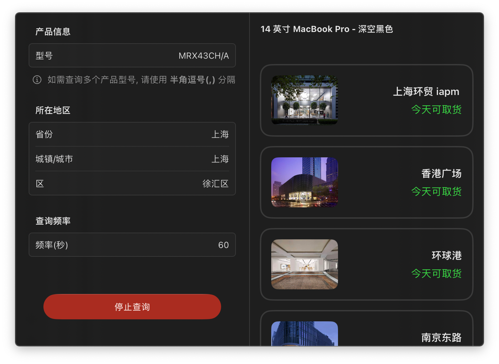

# AppleStoreInventoryTracker

一款能定时监测附近 Apple Store 指定产品的实时库存状态的 macOS 菜单栏应用


## TODO

- [ ] UI 定稿
- [x] 支持同时监测多个产品
- [x] 支持 Bark 推送通知

## 请求与扫描逻辑

保持原有“填写参数 → 开始 → 停止”的操作。只查询附近 Apple Store 的到店取货供货情况，不查询配送、下单或预订。使用原生 `URLSession` 直接访问 `https://www.apple.com.cn/shop/retail/pickup-message`，无需 WebKit、Cookie 或浏览器会话。

- 同一地区的型号去重后合并为一次请求（`parts.0`、`parts.1`…），读取 `body.stores` 和 `messageTypes.regular`。上一轮未结束时不会启动新一轮。
- 仅 `pickupDisplay=available` 且没有明确禁止店内取货时才触发有货提醒。`unavailable`、`ineligible` 不触发；未知状态、缺少型号、结构异常均作为查询失败处理，不能仅凭可选择门店就判定有货。
- 停止会取消扫描及待发送通知，旧任务的响应不能覆盖重新开始后的结果。请求失败保留该型号上一次成功结果，不计入成功扫描次数，也不据此推送；有效空响应清除旧结果。
- 被拦截或限流时不立即连发重试；按 `Retry-After` 和逐步延长的失败间隔等待。持续有货时保留原有重复提醒行为。
- 此接口未公开承诺兼容性。错误通过 `[Inventory]` 日志和 `ContentViewModel.lastError` 保留；显示的旧结果不是本轮成功确认的库存。

实现参考了 [woke/apple-store 的取货解析](https://github.com/woke/apple-store/blob/main/src/apple_store/availability.py) 和 [Apple Pickup Watcher 的请求层设计](https://github.com/ENCHIGO/apple-pickup-watcher/blob/main/crates/apw-core/src/apple.rs)：采用批量查询、型号匹配回退、错误与不可取货分离、被拦截后冷却的思路，使用本项目的 Swift 实现。

## 本地验证

在安装 Xcode 的 macOS 上运行 `./scripts/test.sh`。测试编译实际请求层和扫描层，使用模拟 HTTP 响应、可控时钟和通知记录器，覆盖取消、重启、调度、失败恢复、参数编码及列表标识；不会请求 Apple 或发送通知。

可选执行 `./scripts/test.sh --live`：通过实际请求层向 Apple 发出一次两个型号的合并查询（上海长宁区），不发送通知。型号是否仍销售和现场库存会变化，因此该测试不硬编码有货数量。

```sh
xcodebuild -project AppleStoreInventoryTracker.xcodeproj \
  -scheme AppleStoreInventoryTracker -configuration Debug \
  -derivedDataPath /tmp/apple-inventory-build CODE_SIGNING_ALLOWED=NO build
```


## 预览


